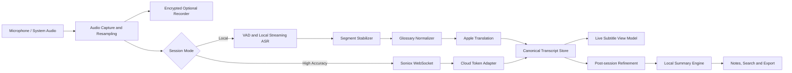

# ClassBridge Product Design

> Working name. A Mac-first bilingual lecture and meeting companion for international students.

## 1. Product decision

ClassBridge focuses on one complete workflow:

1. Select a course by name; materials and glossary are optional.
2. Capture English speech from the microphone or Mac system audio.
3. Display stable English and Chinese subtitles in real time.
4. Mark important moments without interrupting listening.
5. Produce structured bilingual notes after the session.

The product is **local-first**. Soniox is an optional high-accuracy mode selected for difficult rooms, accented speech, important meetings, or sessions where speaker separation matters.

The MVP is a native macOS app, followed by a planned iPhone companion. Shared core packages are a first-release architectural requirement so mobile support does not require a rewrite. The product does not attempt to become a general-purpose interpreter, video meeting client, or LMS in the first release.

## 2. Target user

### Primary persona

An international student attending English-taught university courses who can generally follow the lecturer but loses information when speech is fast, terminology is unfamiliar, or attention is split between listening and note-taking.

### Primary jobs

- Understand the current sentence without waiting for a full translation.
- Verify names, numbers, definitions, assignment requirements, and deadlines.
- Start immediately with only a course name and a rough description.
- Let the course profile learn terminology across successive classes.
- Review what was taught without replaying the full class.
- Keep ordinary classes private and free to process locally.
- Pay for cloud accuracy only when the acoustic environment justifies it.

### Core scenarios

| Scenario | Audio source | Default mode | Reason |
| --- | --- | --- | --- |
| In-person lecture | Mac microphone | Local | Usually one dominant speaker and long duration |
| Online lecture | Selected app/system audio | Local | Clean source audio gives local ASR its best result |
| Tutorial or group meeting | Microphone | Cloud recommended | Multiple speakers and overlap are harder locally |
| Important interview or supervisor meeting | Microphone | Cloud recommended | Names, decisions, and action items are high value |
| Offline/private session | Microphone/system audio | Local only | No network dependency or audio upload |

## 3. Product principles

1. **Listening comes first.** The live screen contains subtitles, status, and marking controls only.
2. **Stable text beats fast flicker.** Provisional English may update quickly, but Chinese is generated from stable clauses.
3. **Cloud use is explicit.** The app never silently changes from local to cloud processing.
4. **Zero preparation is a first-class path.** A course name is enough to start; documents are optional enhancements.
5. **Course context grows over time.** Approved terms, corrections, and prior sessions improve later classes.
6. **Every note is traceable.** Summary items link back to transcript timestamps and, when retained, audio.
7. **The app degrades gracefully.** Network loss, model loading, permissions, and low battery have visible recovery states.

## 4. MVP scope

### Included

- Native SwiftUI macOS app.
- Microphone capture through AVFoundation.
- App/system audio capture through ScreenCaptureKit.
- English speech recognition using an on-device Core ML model.
- English-to-Simplified-Chinese translation using Apple Translation.
- Optional Soniox real-time transcription and translation.
- Lightweight course profiles requiring only a course name.
- Source-attributed course discovery and starter preparation packs.
- Adaptive glossary suggestions from transcripts, corrections, and translation inconsistencies.
- Optional PDF, TXT, and Markdown source document import.
- Local extraction and review of candidate course terms when documents exist.
- Bilingual live subtitles with provisional and final states.
- Bookmark, important point, question, and action-item markers.
- Local transcript, optional audio recording, and structured post-session summary.
- Markdown, plain text, and SRT/VTT export.
- Per-session usage and cloud cost display.

### Deferred

- iPad optimization and cross-device sync. The iPhone companion is already committed to the post-Mac roadmap.
- LMS, Google Drive, OneDrive, Zoom, or Teams integration.
- OCR of slides and camera-based whiteboard capture.
- Automatic speaker naming.
- Full DOCX/PPTX semantic parsing.
- Shared classrooms, accounts, subscription billing, and team administration.
- General two-way travel interpretation.

## 5. Information architecture

The app has four primary destinations:

| Destination | Purpose |
| --- | --- |
| Today | Start a session, resume recent work, inspect model and permission readiness |
| Courses | Manage course profiles, documents, and terminology |
| Sessions | Search and review transcripts, summaries, bookmarks, and exports |
| Settings | Models, privacy, cloud credentials, storage, subtitle appearance |

The menu bar item provides start, pause, bookmark, and stop controls while another app is in front.

## 6. Core user flows

### 6.1 First run

1. Explain local processing and optional cloud processing in one concise privacy screen.
2. Request microphone permission only when microphone capture is selected.
3. Request Screen Recording permission only when app/system audio is selected.
4. Download the English ASR model with size, progress, pause, and retry states.
5. Check whether Apple Translation and the on-device summary model are available.
6. Run a ten-second subtitle test.

The app remains usable for transcript capture if Chinese translation or local summarization is unavailable.

### 6.2 Create a course

The only required field is:

- Course name.

Optional fields:

- Course code.
- One-sentence description of the likely content.
- Lecturer names.
- Broad domain, such as software engineering or finance.

The target translation language is inherited from app settings and can be changed per course.

#### Zero-preparation path

1. The student enters the course name and, if known, one sentence about the subject.
2. The app searches the selected institution's public catalogue and shows likely matches with code, year, trimester, and campus.
3. After the student confirms a match, the app builds a source-attributed starter preparation pack.
4. If no official match exists, the app may generate a small set of clearly marked, unverified starter terms from the course name and rough description.
5. The student can start immediately without reviewing terms or importing anything.
6. After the session, the app proposes candidate terms using repeated technical phrases, acronyms, proper nouns, manual transcript corrections, and inconsistent translations.
7. Only user-approved candidates become recognition or translation preferences for later sessions.

The app must prefer an empty glossary over confident-looking invented terminology. Suggestions never alter future recognition until approved.

#### Automatic preparation pack

The generated pack is a compact context aid, not a claim to reproduce the lecturer's actual slides or weekly plan. It contains:

- Confirmed course code, title, institution, year, trimester, and location.
- Official course description and prerequisites.
- Paper outline topics when a public outline is available.
- A short Chinese course primer.
- Likely English technical terms, abbreviations, names, and preferred Chinese translations.
- A small concept map and prerequisite concepts worth reviewing.
- Source URL, retrieval date, and confidence for every externally derived item.

Source priority is strict:

1. Official university course catalogue and public paper outline.
2. Lecturer or department pages on the institution domain.
3. Official textbook publisher contents and authoritative project documentation.
4. Reputable open educational resources.
5. Model-generated inference, always labelled as inferred.

Do not use student-upload sites, answer banks, scraped assignments, or unattributed summaries as default sources. Do not store full copyrighted pages when a structured description, terms, and links are sufficient.

Course title alone can be ambiguous. The institution comes from the student's profile; year and trimester default to the current study period. When multiple official matches remain, the app asks the student to choose rather than guessing.

For the initial pilot, implement a University of Waikato catalogue provider and a generic course-page URL importer. Add other universities through the same provider interface instead of building a fragile global scraper into the client.

Optional preparation:

- Import syllabus, lecture notes, reading list, and assignment PDF.
- Extract candidate names, abbreviations, technical terms, and preferred translations.
- Review candidates before adding them to the active glossary.

Glossary entries contain the English form, Chinese form, aliases, type, priority, and source.

The course profile therefore becomes more useful over the semester: the first class works with the general model, while later classes benefit from accumulated approved terminology and prior topic summaries.

### 6.3 Start a session

The preflight sheet contains operational choices rather than technical settings:

- Course.
- Lecture or Meeting.
- Microphone, selected app audio, or mixed audio.
- Local or High Accuracy.
- Keep audio: Off, Until summary is ready, or Keep permanently.

For High Accuracy, show the estimated cost before starting. Pricing is configuration data and must not be hard-coded into the app binary.

The app analyzes the first 20 seconds for input level, clipping, speech ratio, and provisional transcript stability. It may recommend High Accuracy, moving closer to the speaker, or changing the source, but it does not switch modes automatically.

### 6.4 Live session

The default layout is a quiet, full-window subtitle surface:

```text
+-----------------------------------------------------------------------+
| COMP501  00:42:18     Mic: Good     Local     Battery 78%       Stop  |
+-----------------------------------------------------------------------+
|                                                                       |
|  The event loop schedules callbacks after the current call stack...  |
|  事件循环会在当前调用栈结束后调度回调……                                  |
|                                                                       |
|  [previous bilingual lines, lower contrast]                           |
|                                                                       |
+-----------------------------------------------------------------------+
|   Bookmark       Important       Question       Action item            |
+-----------------------------------------------------------------------+
```

Interaction rules:

- Current English is visually primary; Chinese is directly below it.
- Provisional English uses lower contrast and is replaced in place.
- A final English clause never changes unless a provider sends a correction.
- Chinese appears only after the English clause is stable enough to avoid flicker.
- Previous lines remain visible for short-term context and can be scrolled.
- Scrolling pauses auto-follow and exposes a single return-to-live control.
- Subtitle scale, line count, and English/Chinese emphasis are adjustable.
- A compact floating subtitle window can stay above slides or a meeting app.
- Keyboard shortcuts perform markers and session control without requiring the user to leave the slide deck.

Meeting mode enables speaker labels where the active engine supports them. Lecture mode prioritizes lower latency and does not spend local compute on diarization by default.

During a zero-preparation session, a transient topic context is built from repeated stable phrases, acronyms, lecturer definitions, and user corrections. It may improve translation and summarization later in the same class, but it does not become a permanent recognition boost until the student approves it after class.

### 6.5 End and summarize

Stopping a session runs a visible, resumable pipeline:

1. Finalize remaining transcript tokens.
2. Normalize timestamps, punctuation, numbers, and glossary terms.
3. Re-translate unstable or incomplete lines using complete sentence context.
4. Generate structured notes in chunks and merge them.
5. Link every note item to supporting transcript segments.

The session result contains:

- Five-line overview.
- Topic outline with timestamps.
- Key concepts and definitions.
- Examples and lecturer explanations.
- Decisions, tasks, assignment requirements, and deadlines.
- Questions the student marked or the transcript left unresolved.
- Course glossary additions suggested during the session.
- Full bilingual transcript.

Users can correct transcript text, edit notes, merge speakers, and regenerate only one summary section.

## 7. Processing modes

### 7.1 Local Standard

Recommended stack:

- Audio: AVAudioEngine and ScreenCaptureKit.
- VAD: FluidAudio local voice activity detection.
- English ASR: benchmark Parakeet Unified English 0.6B and Nemotron Streaming 0.6B through FluidAudio/Core ML.
- Live translation: Apple Translation.
- Summary: Apple Foundation Models when available, with a deterministic fallback summary.
- Storage: SwiftData metadata plus local files for audio and exports.

Local translation receives finalized clauses, not every provisional token. The clause builder commits on punctuation, endpoint detection, or a configurable silence boundary, while enforcing a maximum wait so long lecturer sentences do not block translation.

The local engine maintains two context layers:

- **Approved course context:** persistent names and terms used for recognition boosting, normalization, and translation preferences.
- **Transient session context:** repeated phrases inferred from the current class, used conservatively for translation and summary only.

This separation lets the first class adapt without reinforcing an ASR mistake as a permanent course term.

### 7.2 Cloud High Accuracy

Soniox receives one continuous audio stream and returns transcription and translation tokens over WebSocket. The course profile maps to:

- `general`: course name, rough subject, lecturer, and organization when known.
- `text`: an optional compact passage derived from approved documents or prior-session summaries.
- `terms`: important names, abbreviations, and technical vocabulary.
- `translation_terms`: reviewed English-to-Chinese preferences.

When the student has no material, send only known fields and approved terms. Do not generate a large speculative context solely to fill the request.

Enable speaker diarization for Meeting mode and disable it for ordinary Lecture mode unless testing shows a clear benefit.

Current Soniox real-time sessions have a fixed duration limit. The client should rotate the connection before the limit, carry forward the glossary and recent stable context, and deduplicate the overlap so a two-hour lecture remains one local session. It must also recover from early WebSocket termination without losing already finalized tokens.

For a personal build, store the API key in Keychain. A distributed product must use a backend to issue short-lived credentials; a permanent provider key must never ship in the app.

### 7.3 After-class repair

When audio was retained, a user can enhance an entire session or select a continuous low-quality interval. The repair job replaces segments only after showing a diff and preserves manual corrections.

Do not route isolated low-confidence sentences to Soniox during a local session. Fragment routing loses context and makes timestamps, cost, and duplicate handling harder to reason about.

### 7.4 Planned iPhone companion

The iPhone version is technically viable but has a narrower role than the Mac app:

- In-person lecture microphone capture and bilingual subtitles are fully supported.
- Background microphone recording can continue with the appropriate audio session and background mode, while still handling calls, alarms, route changes, and interruptions.
- Apple Translation remains on-device.
- A lightweight Parakeet EOU 120M streaming model is the preferred local mobile baseline.
- A higher-accuracy 0.6B model is optional for newer devices after memory, model-load, thermal, and battery testing.
- Soniox is the recommended high-accuracy and older-device path.
- Capturing arbitrary audio from another iOS app is not equivalent to macOS ScreenCaptureKit. ReplayKit requires explicit screen recording or broadcasting and has content and lifecycle constraints, so same-device online-class capture is not an MVP promise.

Build shared Swift packages for transcript events, course context, engine protocols, translation batching, persistence models, and summary schemas. Keep only audio capture and window/navigation UI platform-specific.

The committed sequence is Mac MVP first, followed by an iPhone microphone-caption companion. The iPhone release should not delay validation of the Mac classroom pipeline.

## 8. System architecture



### Engine interfaces

The application layer depends on protocols rather than vendors:

```swift
protocol SpeechRecognitionEngine {
    func start(configuration: RecognitionConfiguration) async throws
    func accept(_ audio: AudioFrame) async throws
    var events: AsyncStream<RecognitionEvent> { get }
    func finalize() async throws
}

protocol TranslationEngine {
    func translate(_ segment: StableSegment, context: TranslationContext) async throws -> Translation
}

protocol SummaryEngine {
    func summarize(_ transcript: SessionTranscript, course: CourseContext) async throws -> SessionSummary
}

protocol CourseSourceProvider {
    func search(_ query: CourseQuery) async throws -> [CourseMatch]
    func fetch(_ match: CourseMatch) async throws -> SourcedCourseContext
}
```

Implementations:

- `LocalSpeechRecognitionEngine`
- `SonioxSpeechRecognitionEngine`
- `AppleTranslationEngine`
- `SonioxTranslationAdapter`
- `AppleFoundationSummaryEngine`
- `DeterministicSummaryFallback`
- `WaikatoCourseSourceProvider`
- `OfficialCoursePageImporter`

All provider output is converted into one canonical event model before reaching the UI.

### Transcript state model

Each segment moves forward through explicit states:

```text
captured -> provisional -> final -> normalized -> translated -> summarized
```

A segment stores provider, confidence or quality signals, source timestamps, speaker, glossary matches, revision origin, and whether the user manually corrected it. Manual corrections are immutable to automatic repair unless the user approves replacement.

## 9. Data model

| Entity | Important fields |
| --- | --- |
| Course | id, name, code, roughDescription, domain, lecturers, targetLanguage, contextMaturity |
| CourseSource | courseId, provider, sourceURL, sourceType, retrievedAt, contentHash, confidence |
| PreparationPack | courseId, version, officialFacts, primer, concepts, sourceRefs, generatedAt |
| SourceDocument | courseId, filename, hash, extractedText, importedAt |
| GlossaryTerm | courseId, source, target, aliases, type, priority, origin, confidence, approved |
| Session | courseId, mode, audioSource, provider, startedAt, duration, status |
| TranscriptSegment | sessionId, start, end, sourceText, translatedText, speaker, state |
| Marker | sessionId, timestamp, type, note |
| Summary | sessionId, version, structuredSections, generatedAt |
| AudioAsset | sessionId, URL, retentionPolicy, encryptionMetadata |
| UsageRecord | sessionId, provider, audioSeconds, estimatedCost, finalCost |

Document text, transcripts, and audio remain local by default. Search should use a local full-text index and never require an account.

## 10. Privacy and reliability

- Make recording retention an explicit pre-session choice.
- Show a persistent recording indicator whenever audio is written to disk.
- Encrypt retained audio and transcripts using keys protected by Keychain.
- Provide one-click deletion for audio only, transcript only, or the full session.
- Display whether audio is being processed locally or streamed to a provider.
- Do not upload imported course documents; derive a compact, reviewed context locally.
- Fetch public catalogue pages through allowlisted providers and retain source links for inspection.
- Do not request or store university portal credentials in the MVP.
- Buffer a short rolling audio window during cloud interruptions and reconnect within a bounded period.
- Commit finalized transcript events transactionally so an app crash does not lose the completed class.
- Support sessions longer than two hours in soak tests.

The product must remind users to follow classroom, institution, and participant recording rules without pretending to determine whether a specific recording is lawful.

## 11. Quality and product metrics

### Release targets on the reference 14-inch M5 MacBook, 32GB

| Metric | MVP target |
| --- | --- |
| Time from Start to ready | Under 5 seconds after model warm-up |
| Provisional English p95 | Under 1.2 seconds behind speech |
| Stable bilingual subtitle p95 | Under 3.5 seconds behind speech |
| Two-hour session transcript loss | Zero finalized segments |
| Clean lecture critical-term recall | At least 90% on the project test set |
| First class without materials | Useful bilingual subtitles without requiring glossary review |
| Normal lecture local vs cloud gap | No more than 3 extra critical errors per 100 words for local-default approval |
| Local 90-minute battery use | Target at or below 25%, then optimize from measurement |
| Cloud 90-minute battery use | Target at or below 15% |
| Crash-free sessions | At least 99.5% |

Critical errors receive more weight than ordinary WER:

- Negation changes.
- Names and technical terms.
- Numbers, dates, formulas, and units.
- Assignment requirements and deadlines.
- Missing complete clauses.

### Evaluation set

Build a private, consented test set with at least:

- Front-row lecture.
- Back-row lecture.
- Lecturer with a non-US accent.
- Online lecture captured from system audio.
- Tutorial with multiple speakers.
- Noisy group meeting.

Run identical audio through Parakeet, Nemotron, and Soniox. Measure English WER, critical-error rate, glossary recall, subtitle latency, Chinese adequacy, battery use, temperature, and memory pressure.

## 12. Cost strategy

- Local Standard has zero marginal API cost.
- High Accuracy displays the estimated cost per session and cumulative monthly usage.
- The app records provider token/audio usage and reconciles it with billing data where available.
- A user can set a monthly cloud budget and receive warnings at 50%, 80%, and 100%.
- Reaching the budget never breaks an active cloud session; it affects the next start decision.
- Post-session summary remains local so cloud speech usage is the only required variable cost.

For a future commercial version, sensible packaging is:

- Free: unlimited local processing.
- Bring Your Own Key: cloud provider selected by the user.
- Plus: included cloud-hour allowance and managed credentials.

## 13. Error and recovery states

| Failure | Product behavior |
| --- | --- |
| Microphone permission denied | Keep app usable and open the correct System Settings location |
| Screen capture permission denied | Offer microphone capture without discarding session setup |
| Local model missing | Show download size and allow cloud mode if configured |
| Apple Translation unavailable | Continue English subtitles and queue translation retry |
| Soniox disconnects | Buffer briefly, reconnect, and mark any unrecoverable audio gap |
| Cloud budget reached | Warn before the next session; never silently switch mid-session |
| Low battery | Recommend local efficiency mode or cloud mode based on network availability |
| Summary context too long | Chunk by topic and timestamps, then merge structured partial summaries |
| App relaunch after crash | Restore the unfinished session and finalize committed transcript segments |

## 14. Key risks and decisions

| Risk | Decision or mitigation |
| --- | --- |
| A laptop microphone cannot recover speech that is physically too distant | Run the acoustic preflight, show input quality, test front/middle/back-row audio, and recommend an external microphone where appropriate |
| Fast provisional text creates unreadable Chinese flicker | Translate stable clauses and enforce a maximum clause wait rather than translating every token |
| On-device models increase download size and first-run friction | Download models after installation with resumable progress; ship no duplicate model formats |
| Apple framework availability varies by OS, locale, and device | Treat translation and summary capabilities independently and provide explicit fallbacks |
| Provider limits or prices change | Keep limits and pricing in signed remote configuration, while retaining conservative local defaults |
| Course material may contain copyrighted or sensitive content | Extract context locally and send only reviewed terms and compact context required for the active cloud session |
| A course title matches the wrong institution, year, or paper | Bind lookup to institution and study period, show the official match, and require confirmation when ambiguous |
| Public catalogue HTML changes | Isolate each institution behind a tested provider adapter and support direct course-page URL import |
| Recording rules differ by institution and situation | Require a clear retention choice and provide reminders and visible recording state without offering legal conclusions |
| Local and cloud transcripts may diverge during repair | Use canonical timestamps, segment revisions, and a user-visible diff before replacing text |

For the first engineering release, target macOS 26 on Apple Silicon. This keeps the local model, Translation, ScreenCaptureKit, and optional Foundation Models paths coherent. Supporting older macOS versions should be a separate compatibility decision after the vertical slice works.

## 15. Development plan

### Phase 0: quality spike, 1-2 weeks

- Capture representative audio.
- Benchmark Parakeet Unified, Nemotron Streaming, and Soniox.
- Validate Apple Translation on stable and fragmented clauses.
- Measure battery and thermal behavior on the target Mac.
- Select the local ASR model and subtitle commit policy.

Do not build the full interface before this decision; ASR event behavior determines much of the live subtitle architecture.

### Phase 1: local vertical slice, 2-3 weeks

- SwiftUI shell and session state machine.
- Microphone and system audio capture.
- Local streaming ASR and bilingual subtitle surface.
- Local persistence and basic transcript review.

### Phase 2: course intelligence, 2 weeks

- Zero-preparation course profiles and adaptive context maturity.
- University of Waikato catalogue provider and source-attributed preparation pack.
- Generic official course-page URL importer.
- Term mining from transcripts, corrections, acronyms, and translation inconsistencies.
- Optional PDF/TXT/Markdown import.
- Glossary review, matching, and translation preferences.
- Markers and structured local summary.
- Timestamp-linked review and exports.

### Phase 3: cloud enhancement, 1-2 weeks

- Soniox WebSocket adapter and short-lived credential design.
- Cost estimation, usage tracking, reconnect, and session rotation.
- Meeting mode and speaker labels.
- After-class repair workflow.

### Phase 4: hardening, 2 weeks

- Two-hour soak tests and crash recovery.
- Permission and first-run polish.
- Battery, memory, and model-loading optimization.
- Accessibility, subtitle scaling, keyboard navigation, and export validation.

A focused solo-developer MVP is approximately 8-10 weeks after the quality spike. The first usable local vertical slice should exist much earlier.

### Phase 5: iPhone companion, 3-5 additional weeks

- Reuse the shared core package and implement AVAudioSession capture.
- Benchmark Parakeet EOU 120M, a 0.6B option, and Soniox on representative iPhones.
- Add foreground and background session recovery, interruption handling, and thermal adaptation.
- Build a phone-sized subtitle view and optional cross-device session transfer.
- Treat ReplayKit capture as an experimental feature, not a launch dependency.

## 16. Acceptance boundary

The MVP is ready for a student pilot when a user can:

1. Install the app and complete permissions without developer assistance.
2. Create a course using only its name and start without importing material.
3. Confirm an official course match and inspect the sources behind its preparation pack.
4. Run a 90-minute local lecture with stable bilingual subtitles.
5. Mark important moments while another app remains in front.
6. Receive a timestamp-linked summary and export it.
7. Repeat the same session using Soniox with an upfront cost estimate.
8. Recover from one network interruption without losing finalized text.
9. Delete all retained session data from within the app.

## 17. External implementation references

- [FluidAudio](https://github.com/FluidInference/FluidAudio)
- [FluidAudio benchmarks](https://github.com/FluidInference/FluidAudio/blob/main/Documentation/Benchmarks.md)
- [Soniox WebSocket API](https://soniox.com/docs/api-reference/stt/websocket-api)
- [Soniox real-time considerations](https://soniox.com/docs/stt/core-concepts/real-time-considerations)
- [Soniox pricing](https://soniox.com/pricing)
- [Apple ScreenCaptureKit](https://developer.apple.com/documentation/screencapturekit)
- [Apple TranslationSession](https://developer.apple.com/documentation/translation/translationsession)
- [Apple Foundation Models](https://developer.apple.com/documentation/foundationmodels/languagemodelsession)
- [University of Waikato paper catalogue](https://www.waikato.ac.nz/study/papers/)
