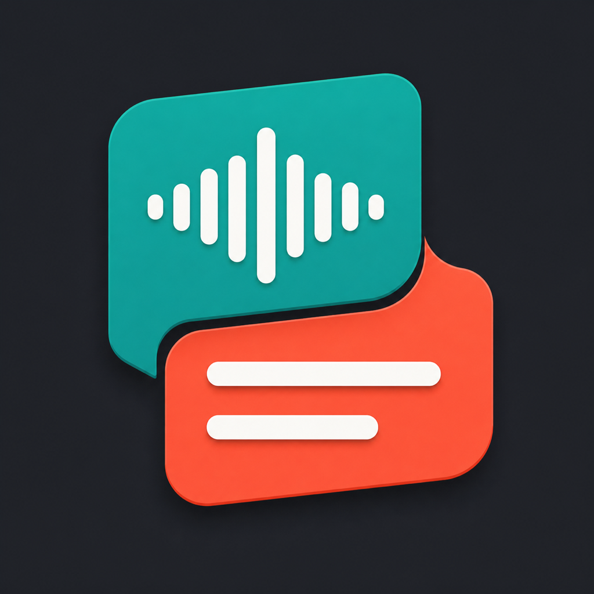

# LingoSlate



LingoSlate is a local-first bilingual classroom companion for international students. The first product is a native macOS app; the shared Swift core is designed for a planned iPhone companion. Product, package, application, and developer-tool names now use the LingoSlate brand consistently.

## Current slice

This repository currently contains the first local microphone vertical slice:

- Cross-platform course, session, glossary, marker, and transcript models.
- Replaceable speech recognition, translation, and summary protocols.
- Session lifecycle validation.
- A bilingual subtitle pipeline with provisional and final segment handling.
- Incremental atomic JSON checkpoints, failure-path salvage, and interrupted-session recovery.
- AVAudioEngine microphone permission, capture, and 16 kHz mono conversion.
- FluidAudio Parakeet EOU 120M energy-saving recognition with adaptive gain and limiting.
- FluidAudio Parakeet Unified 0.6B high-accuracy streaming recognition at 1120 ms context.
- Optional Soniox `stt-rt-v5` cloud recognition and English-to-Chinese translation with language
  identification, endpoint detection, speaker labels, and reviewed recognition/translation terms.
- An automatic offline transcription pass that preserves recognition time boundaries before high-accuracy sessions are saved.
- Streaming 48 kbps AAC M4A recording on a dedicated bounded write path, separate from the ASR queue.
- Conservative course-name spelling repair, title phrase extraction, and domain term packs for proper nouns and technical vocabulary.
- Local user profile settings for school and country or region.
- Course warmup that prepares editable terms, preloads transcription and translation models, and persists whether the warmed recognition engine was reused.
- On-device English-to-Simplified-Chinese translation through Apple Translation.
- Contextual high-accuracy translation: Apple Translation appears first; after each group of
  three live segments, all three are refined by TranslateGemma 4B using its strict translation
  template. Course and nearby English context are used only for conservative terminology
  disambiguation before every post-class segment is refined.
- High-accuracy sessions start loading TranslateGemma automatically; manual course warmup remains
  optional. Saved segments record whether Apple quick translation or TranslateGemma produced the
  final text, and completion is reported only when all eligible segments are refined.
- Predominantly Chinese student discussion is retained in the source transcript but excluded from
  translation context, local translation, and post-class summaries.
- Phrase-level New Zealand academic terminology for ambiguous course language such as
  paper outlines, lab attendance, and tutorial priority.
- Global academic aliases for Overleaf, IEEE, ACM, Scopus, citations, peer evaluation,
  and mark deductions so spoken variants can be repaired before translation.
- Verbatim protection for course codes and institution-specific names, plus a quality gate
  that keeps the Apple draft when a refined translation loses a number, negation, or protected term.
- Strict TranslateGemma translation prompts, requirement/modality checks, and computing term
  protection for LLM, Kotlin, Jetpack Compose, XML, and related classroom language.
- Automatic Traditional-to-Simplified Chinese normalization on local refined translations.
- Bounded, retryable translation jobs so English subtitles remain responsive and session completion has a deadline.
- Automatic post-class summaries using Apple Foundation Models with a deterministic local fallback.
- Persisted overview, key concepts, timestamped tasks, and a summary/transcript review switcher.
- Audio-input preflight that reports a missing microphone instead of crashing on headless Macs.
- Explicit CoreAudio input-device selection for MacBook, external, and available iPhone
  Continuity microphones, persisted by device UID, with a 15-second record-and-play test.
- Persisted input-device identity, sample rate, route-change count, and ASR/recording drop counters.
- Optional lecturer name and Indian English profile, with cloud-service aliases constrained by
  both prepared course terms and sentence context.
- Inline English transcript correction, immediate Chinese retranslation, and correction history
  scoped to course, lecturer, and accent.
- A native SwiftUI macOS workspace with live input level and real subtitle events.
- Sustained low-input warnings and clause-aware 36-word post-class translation chunks.
- One hundred and six tests across the shared core, Soniox adapter, audio capture, translation, summary, migration, persistence, failure recovery, and macOS UI adapters.

Energy-saving mode is the default and downloads an approximately 120 MB model. High-accuracy mode progressively caches approximately 1.2 GB for its real-time and after-class encoders. Course warmup also downloads a pinned approximately 2.22 GB MLX TranslateGemma model for the second-stage translation pass. Audio streams to disk in bounded chunks, and the after-class pass reads it back in 16,000-sample chunks instead of keeping a full class in memory. UI snapshots retain only the latest pending value, microphone-level updates are capped at 10 Hz, and heavyweight high-accuracy models prepare sequentially. The TranslateGemma container stays warm for 15 minutes after a high-accuracy session, then its MLX buffer cache is released; switching to energy-saving mode releases it immediately, while downloaded weights remain cached. In the two local modes, audio, recognition, and translation remain on the Mac. Soniox mode sends 16 kHz microphone audio and prepared course context to Soniox and receives separate original and Chinese translation tokens; local recording, session storage, and summary generation remain on the Mac. Apple may ask the user to download the English and Simplified Chinese language package when a local mode first prepares translation. TranslateGemma is distributed under the [Gemma terms](https://ai.google.dev/gemma/terms) and is downloaded separately rather than bundled in LingoSlate.

Course warmup also prepares Apple Translation so the first stable English clause can be translated without waiting for language-model setup. On macOS 26 or later, warmup uses the on-device Apple Foundation Model when available to propose likely English terminology. The suggestions remain editable before the class starts. When Apple Intelligence is unavailable, LingoSlate still warms the ASR model and derives conservative terms from the course and school names. The workspace shows the prepared term count, and the saved session records model readiness, generated terms, and whether the prewarmed recognition engine was actually reused.

After a session ends, LingoSlate stores a local summary beside the bilingual transcript. Apple Foundation Models produces a concise Chinese summary when available. The fallback remains useful without Apple Intelligence by extracting translated overview points, course terminology, repeated concepts, and timestamped assignment or deadline cues.

## Local session data

Course name is optional. A blank name does not block recording, transcription, translation, or
model warmup; adding one only improves terminology preparation and later organization.

Completed sessions are stored as JSON under
`~/Library/Application Support/LingoSlate/Sessions/`. Each file contains session settings,
timestamps, final English transcript segments, available Chinese translations, markers, and the
post-class summary. The original microphone audio is saved beside the JSON as a 16 kHz mono,
48 kbps AAC M4A file with the same session UUID, typically using about 22 MB per hour. The JSON
stores the matching audio filename, and the completed-session view can play or reveal it in
Finder. Stable transcript and translation segments are checkpointed during class. Audio remains on
the Mac and is written through a dedicated bounded stream so slow ASR cannot directly stall disk
recording. High-accuracy replay reads the saved file in bounded chunks. If the app exits before an
M4A is moved into place, the next launch attempts to recover any readable interrupted recording.
The classroom toolbar also opens a searchable local history view for reviewing summaries and
bilingual transcripts, playing saved audio, revealing files in Finder, and deleting a session with
its linked recording. Each history item can also export a listening-practice folder containing a
copy of the M4A recording, English SRT, bilingual SRT, and a timestamped bilingual text transcript.

## Build

```bash
DEVELOPER_DIR=/Volumes/Disk/Applications/Xcode.app/Contents/Developer swift build --disable-sandbox
DEVELOPER_DIR=/Volumes/Disk/Applications/Xcode.app/Contents/Developer swift test --disable-sandbox
DEVELOPER_DIR=/Volumes/Disk/Applications/Xcode.app/Contents/Developer swift run --disable-sandbox LingoSlateMac
```

Build a foreground development app with microphone permission metadata and an ad-hoc signature:

```bash
./scripts/build-macos-app.sh
open .build/LingoSlate.app
```

The build script generates the full macOS icon set and `LingoSlate.icns` from
`Resources/LingoSlate-AppIcon-v2.png` before signing the app bundle.

To use Soniox, open profile settings in the app and save an API key. LingoSlate stores it in the
macOS Keychain under `com.timmorzhu.LingoSlate.soniox`; it is never written to a session document.
Select `Soniox` in the classroom mode picker. This mode uses Soniox for real-time transcription and
Chinese translation while retaining the recording, bilingual transcript, and summary locally.

MLX requires Xcode's optional Metal toolchain. Install it once before the first app build:

```bash
DEVELOPER_DIR=/Volumes/Disk/Applications/Xcode.app/Contents/Developer \
  xcodebuild -downloadComponent MetalToolchain
```

For development, `LINGOSLATE_TRANSLATION_MODEL_PATH` may point at an already downloaded
MLX model snapshot, and `LINGOSLATE_MODEL_CACHE_PATH` can move future model downloads to
an external disk. The former `LECCUE_TRANSLATION_MODEL_PATH` and `LECCUE_MODEL_CACHE_PATH`
aliases remain readable during migration, but new configuration should use `LINGOSLATE_*`.

A complete Xcode installation is required for App Store signing, ScreenCaptureKit, and device testing. The script produces a local development bundle, not a release archive.

Run the local recognition adapter against a known audio file:

```bash
swift run LingoSlateASRSmoke /path/to/english-audio.wav
```

## Structure

```text
Sources/
  LingoSlateCore/        Shared macOS/iOS domain and pipeline
  LingoSlateAudio/       Shared local capture and FluidAudio adapters
  LingoSlateSoniox/      Foundation-only Soniox adapter for macOS/iOS
  LingoSlateMobile/      iOS capture, persistence, history, and caption UI
  LingoSlateTranslation/ Native MLX translation adapter
  LingoSlateMac/         Native macOS application
  LingoSlateASRSmoke/    Local/Soniox audio-file bilingual smoke tool
  LingoSlateBenchmark/   Private same-audio ASR benchmark
  LingoSlateTranscriptBenchmark/ External Whisper transcript benchmark
  LingoSlateTranslationBenchmark/ Private sampled translation benchmark
Tests/
  LingoSlateCoreTests/   Shared core tests
  LingoSlateMacTests/    macOS translation, summary, and UI adapter tests
  LingoSlateMobileTests/ Mobile session and permission tests
Apps/
  LingoSlateIOS/         Native iPhone application target
```

The iPhone target is in `Apps/LingoSlateIOS/LingoSlateIOS.xcodeproj`. Its settings
screen stores the broker URL in preferences and its rotatable broker token in
iOS Keychain. The zero-dependency Cloudflare Worker in
`Backend/soniox-key-broker` returns `{"api_key":"temp:..."}`; the backend, not the
app, creates a single-use Soniox `transcribe_websocket` key from the permanent key.

See [PRODUCT_DESIGN.md](PRODUCT_DESIGN.md) for product scope, architecture, quality targets, and roadmap.
